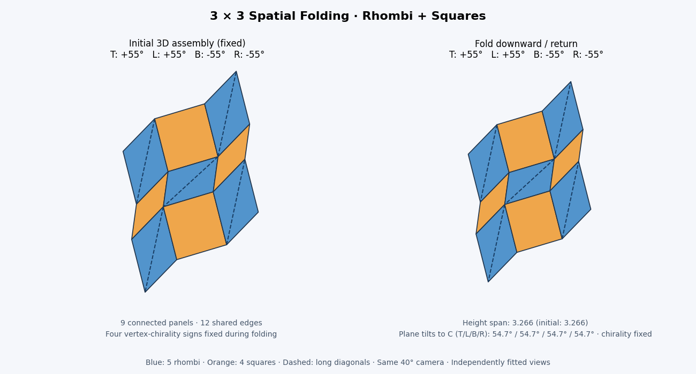

# Clipping-papers

刚性折纸（rigid origami）实验代码，参考论文 *Flexible quadrilateral mesh of isogonal type in arbitrary size*。

## 3×3 折叠演示

当前模型由 9 个边长为 1 的面片组成：中心和四角是 60°/120° 菱形，其余四片是正方形。四角菱形旋转 90° 后与中心菱形保持相同方向，再通过正方形连接成空间铰接网格。



左侧显示初始拼接，右侧显示折叠过程。蓝色为菱形，橙色为正方形，虚线标出菱形长对角线。模型在折叠过程中保持：

- 9 个面片刚性不变，12 条公共边始终重合；
- 五个菱形消除空间倾斜后方向一致；
- 四个内部交点的凹凸关系不发生翻转；
- 初态和末态均为非共面结构，当前分支具有一个局部自由度。

## 运行

```bash
pip install numpy matplotlib pillow
python origami_grid3x3.py
python origami_grid3x3.py --check-only
python origami_grid3x3.py --audit-branches
```

自定义折叠角度和帧数：

```bash
python origami_grid3x3.py --start-angle 60 --end-angle 120 --steps 80 --output custom_fold.gif
```

## 输出

- `origami_grid3x3_rhombi_squares.gif`：折叠动画；
- `origami_grid3x3_rhombi_squares_assembled.png`：初始拼接；
- `origami_grid3x3_rhombi_squares.png`：默认折叠末态。

空间拼接参考：[GeoGebra 示意图](https://www.geogebra.org/calculator/hsd9hkzw)。

论文：Y. Liu, J. Cheng, *Flexible quadrilateral mesh of isogonal type in arbitrary size*, ACM Transactions on Graphics 37(4).
